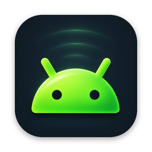
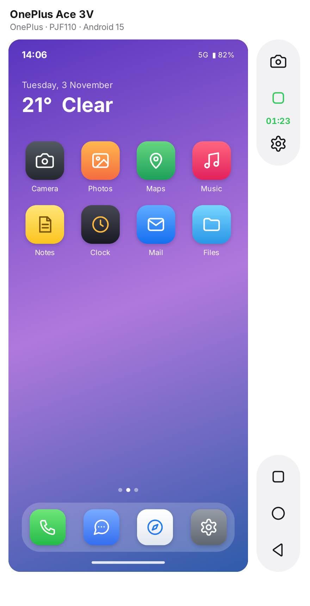
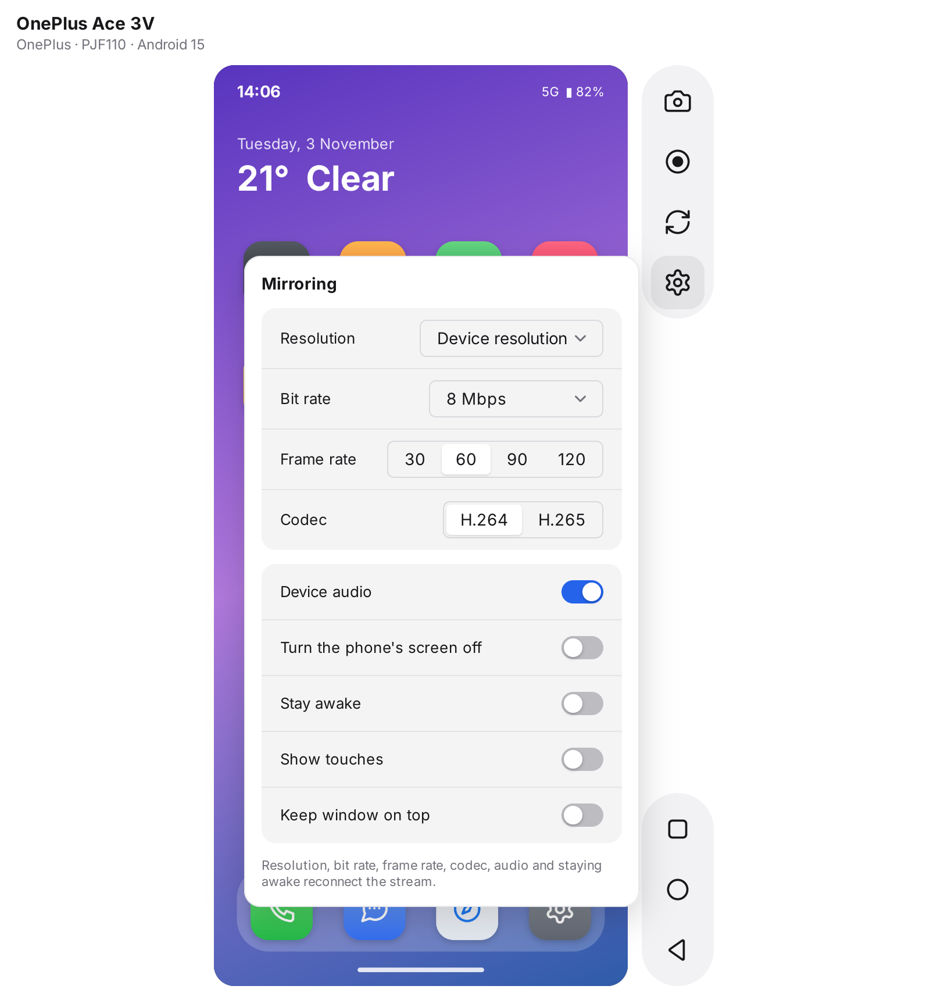
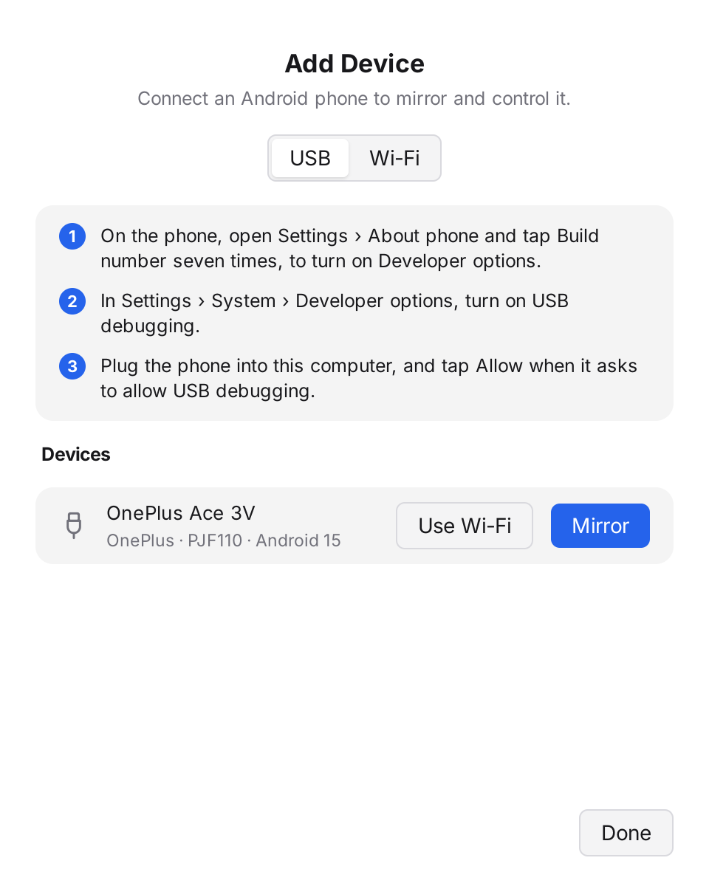
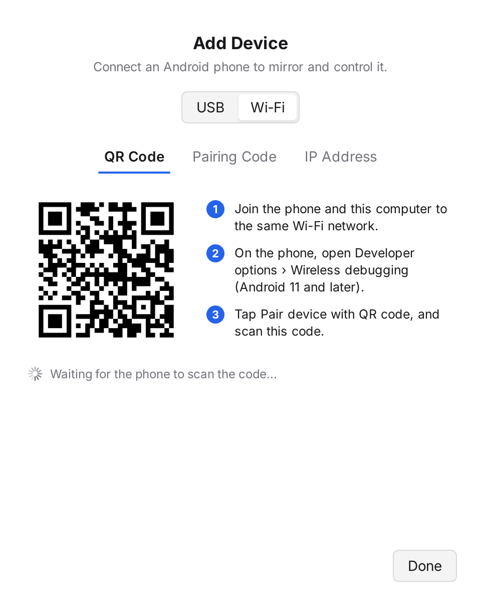
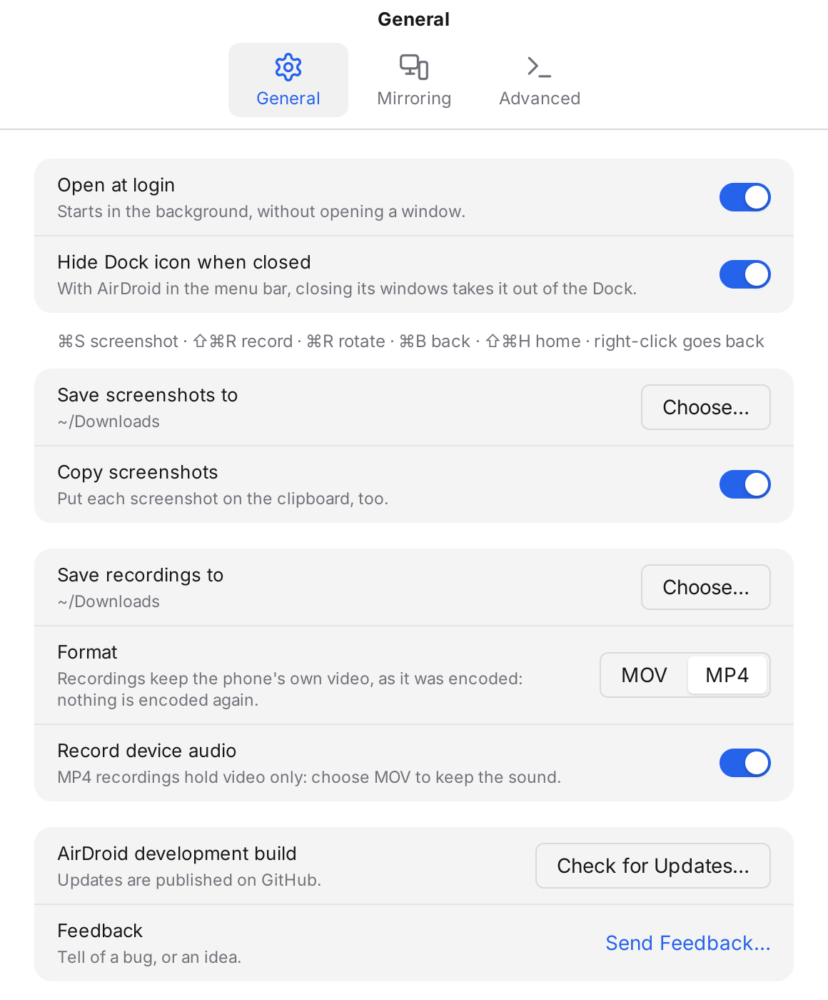
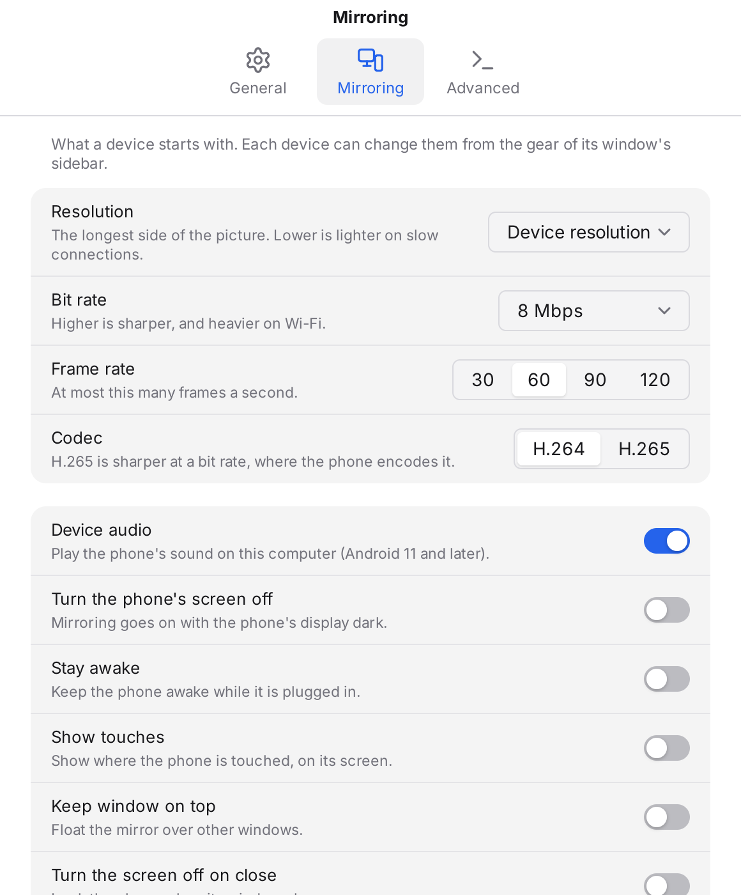

<h1 align="center">AirDroid</h1>

  <b>Your Android phone, on your desktop.</b> 
  Mirror it, control it, screenshot and record it, over USB or Wi-Fi, on macOS, Windows and Linux.

  
  
  
  
  
  

<a href="#features">Features</a> · <a href="#install">Install</a> · <a href="#keyboard-shortcuts">Shortcuts</a> · <a href="#privacy">Privacy</a> · <a href="#known-limits">Known limits</a> · <a href="docs/development.md">Build from source</a> · <a href="#licence">Licence</a>

AirDroid lives in the menu bar on a Mac, and in the system tray on Windows
and Linux. Plug in your Android phone, or pair it over Wi-Fi, and it opens in
a window on your computer. The window is as sharp and smooth as the phone
itself, with its sound. Tap with the mouse, type with the keyboard, paste
from the computer, take screenshots and record the screen from a small
sidebar beside it.

It is a native app built in Go with [MyGo](https://github.com/egoist/mygo),
with no browser engine inside. It needs nothing installed on the phone or the
computer: `adb`, [scrcpy](https://github.com/Genymobile/scrcpy) and, on
Windows and Linux, FFmpeg come inside the app.

## Features

### Mirror and control

- **The phone's screen in a window**, up to its full resolution and 120 frames
  a second. The video is decoded and scaled to the window before it is drawn,
  on the GPU on a Mac, so even a large window stays light. Resize it and the
  picture keeps its shape; rotate the phone and the window turns with it.
- **Use it as you use the phone.** Click and drag to tap and swipe, and scroll
  with the trackpad or the wheel. Right-click goes back, middle-click goes
  home.
- **Type with your keyboard,** in any language and with your input methods.
  Chinese, Japanese, emoji: what Android cannot type directly, AirDroid pastes
  for you.
- **One clipboard.** ⌘V (Ctrl+V on Windows and Linux) pastes what you copied
  on the computer into the phone, and what you copy on the phone is ready to
  paste on the computer.
- **The phone's sound plays on your computer** (Android 11 and later).

### A sidebar of shortcuts

| Recording | Device settings |
|---|---|
|  |  |

Beside the picture, two small groups of buttons, each with a tooltip and its
shortcut:

- **Screenshot** saves a full-resolution PNG and copies it, with a flash to say
  it's done.
- **Record** starts recording at once, and turns into a red stop button with a
  timer while it runs.
- **Rotate** turns the phone between portrait and landscape.
- **Settings** sets this phone's resolution, bit rate, frame rate, codec,
  sound, screen-off and stay-awake, without leaving the window.
- **Recent apps, Home and Back,** as on the phone.

### Recording that costs nothing

- **No quality lost, no fans spinning.** AirDroid records the video exactly as
  the phone sends it: nothing is decoded or compressed again. A recording takes
  no extra CPU or GPU, and the picture stays as smooth while you record.
- **It starts the moment you press the button,** at the frame you see, with no
  wait.
- **Never interrupts you.** Recording runs in the background, so mirroring and
  input never stutter. If the disk fills up, the recording stops and says why,
  and mirroring goes on.
- **MOV with sound, or MP4,** playable in QuickTime, VLC, video editors and
  everywhere else. Rotate the phone during a recording and AirDroid starts a
  new file, so each video keeps one shape.
- **Safe on quit:** quitting while recording finishes the file first.

### Add a phone, over USB or Wi-Fi

| USB | Wi-Fi |
|---|---|
|  |  |

- **USB:** three steps to turn on USB debugging, and the phone shows up as soon
  as it's plugged in, with what to do if it asks for permission.
- **Wi-Fi, by QR code:** on Android 11 and later, scan the code from *Wireless
  debugging*. AirDroid pairs and connects; no cable needed, ever.
- **Wi-Fi, by pairing code or address,** for any phone; recent addresses are
  one click away.
- **Cut the cable:** *Use Wi-Fi* moves a phone plugged in over USB to Wi-Fi,
  so you can unplug it and carry on.

### In the menu bar or the system tray

- **Every phone at a glance:** connected, waiting for permission or offline,
  over USB or Wi-Fi. Click one to mirror it.
- **Phones you used over Wi-Fi** reconnect from the menu.
- **While a recording runs,** the icon shows a red dot and the menu offers
  *Stop Recording*.
- **On a Mac, AirDroid stays out of the Dock** until you open a window, and
  leaves it when you close them (you can keep it there in Settings).

### Settings

| General | Mirroring |
|---|---|
|  |  |

- **General:**
  - Open at login, and on a Mac, the Dock icon.
  - Where screenshots and recordings go: your Downloads folder, unless you
    choose another.
  - Whether screenshots are copied too.
  - MOV or MP4, and the phone's sound in recordings.
- **Mirroring:** the defaults for every phone: resolution, bit rate, frame rate, H.264 or
  H.265, sound, the phone's screen off while mirroring, stay awake, show
  touches, and keep the window on top. Each phone can have its own, from its
  window's sidebar.
- **Advanced:** AirDroid comes with `adb` and `scrcpy`, and can use yours
  instead, such as Homebrew's, your Linux distribution's or Android Studio's,
  showing the version of each.

## Install

**Requirements**
- **macOS** 12 or later, Apple silicon or Intel.
- **Windows** 10 or 11, x64.
- **Linux** x64 with GTK 3 and, for the tray icon, `libayatana-appindicator3`
  (Debian, Ubuntu, Fedora, Arch and others).
- An Android phone with **USB debugging** on (Android 5 and later).
  - Sound needs Android 11 or later.
  - Pairing over Wi-Fi without a cable needs Android 11 or later.

**Download** the latest release from
[Releases](https://github.com/CapyTown/AirDroid/releases):

| | | |
|---|---|---|
| macOS | `airdroid-<version>.dmg` | Drag **AirDroid** to Applications and open it. Its icon appears in the menu bar. |
| Windows | `airdroid-setup-<version>-amd64.exe` | Run the installer, then open AirDroid from the Start menu. Its icon appears in the system tray. |
| Linux | `airdroid_<version>_amd64.deb`, or `airdroid-<version>-linux-amd64.tar.gz` | Install the package (`sudo apt install ./airdroid_*.deb`), or unpack the archive and run `sh install.sh`. Open AirDroid from your applications. |

Then choose **Add Device…** from AirDroid's icon and follow the steps for USB
or Wi-Fi.

**On the phone:** open *Settings › About phone*, tap *Build number* seven
times, then turn on *USB debugging* in *Developer options*. The first time you
connect, tap **Allow** on the phone.

## Keyboard shortcuts

On Windows and Linux, Ctrl takes the place of ⌘.

| macOS | Windows and Linux | |
|---|---|---|
| ⌘S | Ctrl+S | Screenshot |
| ⇧⌘R | Ctrl+Shift+R | Start or stop recording |
| ⌘R | Ctrl+R | Rotate |
| ⌘I | Ctrl+I | This phone's settings |
| ⌘B · ⇧⌘H · ⇧⌘A | Ctrl+B · Ctrl+Shift+H · Ctrl+Shift+A | Back · Home · Recent apps |
| ⇧⌘N | Ctrl+Shift+N | Pull down the notifications |
| ⌘↑ · ⌘↓ · ⌘P | Ctrl+↑ · Ctrl+↓ · Ctrl+P | Volume up · Volume down · Power |
| ⌘V | Ctrl+V | Paste the computer's clipboard on the phone |
| ⌘N · ⌘, | Ctrl+N · Ctrl+, | Add Device · Settings |
| Right-click · Middle-click | Right-click · Middle-click | Back · Home |

## Privacy

- **Everything stays between your computer and your phone.** The picture, the sound
  and your typing go over the USB cable or your own Wi-Fi network, and nowhere
  else.
- **No account, no analytics, no cloud.** AirDroid sends nothing about you
  anywhere. It connects to the internet only when you click *Check for
  Updates* or *Send Feedback*, which open GitHub in your browser.
- **Nothing is installed on the phone.** The small scrcpy server AirDroid
  starts runs only while a window is open, and leaves the phone as it was:
  settings such as *show touches* and *stay awake* go back when you close the
  window.
- Screenshots and recordings are saved where you choose, and nowhere else.
- On a Mac, macOS asks once for **Local Network** access, which Wi-Fi pairing
  and connecting need.

## Known limits

- **Recording sound** needs MOV: MP4 recordings hold the video only. Both are
  set in Settings › General.
- **Sound** comes from Android 11 and later; on older phones, AirDroid mirrors
  the picture alone.
- **Codecs:** H.264 and H.265, decoded by the Mac's hardware, and by the
  bundled FFmpeg on Windows and Linux. Choose H.264 for older phones whose
  H.265 encoder is unreliable, or for a smoother picture on a slower PC.
- **Windows:** some phones need their maker's USB driver (or Google's) before
  `adb` sees them over USB; Wi-Fi needs none.
- **Linux:** to use a phone over USB without root, your user needs access to
  the device (the `android-udev-rules` package, or your distribution's
  equivalent).
- **One finger:** the mouse is a single touch; pinch gestures are not sent yet.
  *Open in scrcpy Window* (in the Device menu) opens the phone in scrcpy's own
  window for what AirDroid's does not do.
- **Releases are not code-signed yet:** macOS asks you to confirm the first
  time you open AirDroid (right-click › Open), and Windows SmartScreen may ask
  too (*More info › Run anyway*).

## Credits

- Screen mirroring by [scrcpy](https://github.com/Genymobile/scrcpy) (Apache
  2.0), whose server AirDroid drives, and adb from Android's platform tools
  (Apache 2.0). On Windows and Linux, video is decoded by
  [FFmpeg](https://ffmpeg.org) (GPL), run as a separate program. [escrcpy](https://github.com/viarotel-org/escrcpy) was the
  reference for how to work with scrcpy.
- Built with [MyGo](https://github.com/egoist/mygo) (MIT) and
  [purego](https://github.com/ebitengine/purego) (Apache 2.0).
- Icons from [Lucide](https://lucide.dev) (ISC).

See [third-party notices](docs/third-party-notices.md). How AirDroid works,
how to build it and how to help: [docs/](docs/README.md).

## Licence

AirDroid is released under the [MIT License](LICENSE). The programs it bundles
keep their own licences: scrcpy, scrcpy-server and adb the Apache License 2.0,
and FFmpeg the GPL; see [third-party notices](docs/third-party-notices.md).
